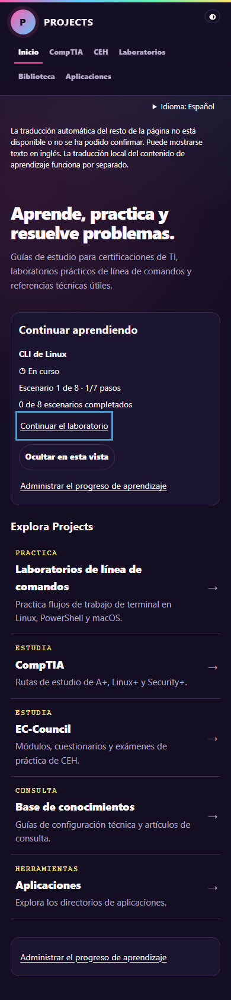
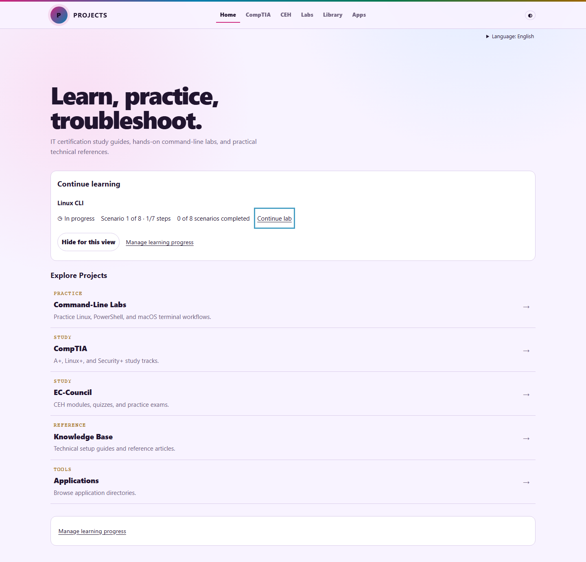
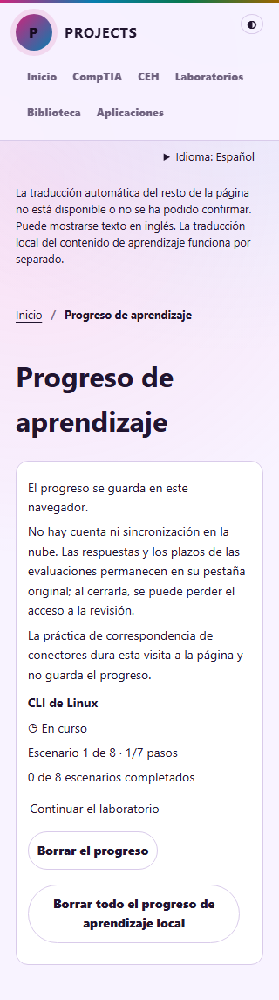
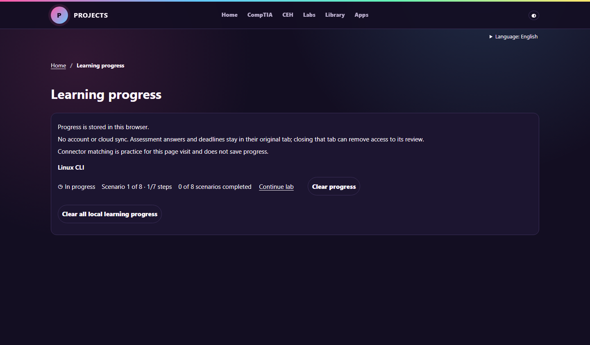

# Local learning progress and resume

Prepared from verified `origin/main` **610647682e8b047ff0ee6e8258c04b5445fd528f**
on `feat/learning-progress-resume`. The working tree was clean before work.

Returning learners get a conditional Continue learning card, a resume/review link,
six small track summaries, and a dedicated progress-management page. Discovery
remains visible and the card can be hidden for the current view. Counts cover
78 actual assessments and 3 CLI labs (18 scenarios), with no certification-complete
claim or invented percentage. Submitted attempts open locked review; expired
attempts return to the existing controller for grading. An idle homepage updates
its expired link in place without grading or replacing the focused link.

The generated inventory uses repository paths and exam versions for identity.
The version-1 local summary stores only started/completed/expired flags, counts,
the latest raw correct/total result and one recency timestamp per activity.
Authoritative assessment sessionStorage and CLI progress-v2 localStorage remain
in place; answers, deadlines, banks and terminal history are not copied. Resume
location comes from existing question/scenario state. Reloads, timer ticks and
language changes do not advance recency. Old stores are read lazily, malformed
summary entries normalize safely, and unknown summary versions are preserved.
See [storage and test details](../../../tests/README.md#local-learning-progress-and-resume).

Everything remains in this browser: no account, cloud synchronization, analytics,
tracking identifiers, progress transmission or external database. Confirmed
single/all clearing removes summaries and authoritative activity state together;
other open tabs clear their own assessment session records and reload without
checkpoint resurrection. Language/theme preferences survive. Storage failures
report incomplete clearing. View-only hiding does not delete progress.
Reading pages receive clear notifications too. A separate version-1 reset map
stores an integer per assessment after explicit clearing; the controller retains
the corresponding optional revision, so an older restored session cannot return.
This map contains no timestamps or answer/deadline data.

Spanish progress UI and activity titles use the existing local catalog with
numeric placeholders. Statuses expose icon plus text, links/buttons work without
hover, and keyboard focus is visible. Mobile summaries remain secondary. This is
Chromium keyboard/DOM verification, not a screen-reader compliance claim.

## Validation

All commands used Python with `-X utf8`. Browser checks used real Chromium and
local HTTP; external HTTPS was blocked and the real Spanish catalog was used.

| Suite | Final result |
| --- | --- |
| `tests/check_source.py` | PASS: 171 HTML pages, 191 JS blocks, 3038 local references; 5 identical controllers; 0 failures |
| `tests/ux_regression.py` | 32/32 PASS |
| `tests/check_learning_catalog.py` | PASS: 3914 catalog entries; 0 failures |
| `tests/language_regression.py` | 12/12 PASS |
| `tests/mobile_accessibility.py` | 14/14 PASS |
| `tests/navigation_directory.py` | 7/7 PASS |
| `tests/assessment_experience.py` | 21/21 PASS |
| `tests/progress_resume.py` | 31/31 PASS |
| Final compact-layout rerun | 16/16 PASS |
| Final new-browser/expiry-focus checks | 2/2 PASS |
| `tests/build_progress_catalog.py --check` | PASS |
| `git diff --check` | PASS |

The layout matrix covers 320, 390, 768 and 1440 pixels, English/Spanish,
light/dark, keyboard resume, visible focus and CSS-disabled readability.
Question-bank files and all three CLI command datasets are unchanged.

An older UX readiness assertion timed out in controlled-clock animation-frame
polling (31/32). It now waits for the same initialized DOM attribute using the
locator method already used by the assessment suite, retaining the five-second
timeout and page-error assertions. The complete affected suite then passed 32/32.

[Validation summary](validation.json), [progress results](progress-results.json),
[final layout results](layout-results.json), and local raw evidence under
`test-results/progress/` preserve the environment and fixture labels. Controlled
clock expiry, legacy/malformed/future storage and completion/timestamp fixtures
are identified separately from ordinary interaction checks.

## Deployed assessment release

The **pre-implementation** deployed smoke passed in real Chromium with an ordinary
clock, no injected state and external resources allowed: no pre-start deadline,
one deadline on Start, flags/navigation, active reload, English/Spanish round trip,
cancel/confirm submission and locked submitted reload. No confirmed release
regression was found in this focused check. [Deployed report](deployed-smoke.json).
The separate screenshot is local at `test-results/progress/release/submitted.png`.
This checks the existing release, not deployment of this feature branch.

No separate external Google translation-service assertion was run for this
milestone. Local Spanish-catalog results do not establish general-page machine
translation availability.

## Screenshots

## Limits

- Assessment answers, deadlines and locked reviews remain tab-scoped. Another
  tab gets a summary/result plus an original-tab notice, without a fake resume
  link or reconstructed attempt. Closing the original tab may lose review access.
- Clearing coordinates with open same-origin tabs; browser storage policies can
  prevent complete clearing. Unknown future schemas are not silently overwritten.
- Connector matching has no stored activity state; it gets no persistent
  completion claim. Legacy CLI assistance remains explicitly unknown.
- No physical-device or screen-reader session was performed.

Nothing was merged or deployed by this work. Pages was inspected read-only and
publishes from `main`; no workflow, release or repository setting was changed.
